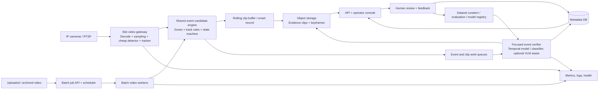

# Video Analytics Platform: Build Specification

**Status:** Proposed architecture  
**Date:** 18 October 2026  
**Scope:** Live and batch video analytics for multiple independently configurable use cases, developed and initially operated on an Apple Silicon MacBook Pro with M5 and unified memory. The design can scale beyond one Mac, but 100+ real-time feeds on a single laptop is a benchmark goal, not an assumed capacity.

## 1. Purpose

Build a platform that detects operational events in video—initially littering and dog-waste-related events—while supporting additional scenarios without deploying a separate system for each one. The system must continuously monitor live camera streams, analyze uploaded or archived video in batch, preserve evidence for review, and keep expensive inference limited to promising clips.

The platform reports **candidate events with evidence and confidence**. It must not assume that a model's prediction is ground truth. Human review and measurable false-positive / missed-event rates are part of the product.

## 2. Requirements

### Functional

- Register, configure, enable, pause, and health-check cameras.
- Support live RTSP streams and batch video files through the same analysis stages.
- Support multiple use cases per camera, with versioned zones, schedules, thresholds, and model/rule versions.
- Detect common entities (initially person, dog, carried/discarded item) and use tracking, rules, and temporal clip analysis to identify candidate events.
- Produce evidence clips, key frames, event metadata, review status, and an audit trail.
- Support operator confirmation, rejection, correction, and feedback export for model improvement.
- Provide search/filter by camera, site, use case, time, confidence, and review state.
- Permit a use case to be enabled or disabled without changing the video ingestion service.

### Non-functional targets (initial SLO proposals)

- Support 100+ configured cameras and horizontal expansion by adding edge gateways and inference workers.
- Live event latency target: p95 under 30 seconds from relevant action to event availability. Tune this to the actual operational need.
- Batch: resumable jobs, configurable priority, progress, and no loss of input on worker restart.
- Isolate one bad camera or job from other sources; bounded queues and explicit backpressure.
- Persist model/config versions and enough evidence to reproduce why an event was produced.
- Encrypt video and event traffic in transit and storage; implement role-based access and configurable retention.

These are starting targets, not capacity claims. Final throughput must be established by a representative benchmark with the selected cameras, codecs, models, and hardware.

## 3. Event definitions before model work

Each use case is a versioned specification, not just a class label. It defines:

- What counts as a positive event and what does not.
- Required visual evidence and temporal order.
- Relevant object/person/dog classes and interaction signals.
- Camera zones, direction, minimum duration, and any cooldown/deduplication rule.
- Which outcomes are `candidate`, `confirmed`, `rejected`, or `needs_review`.
- Evaluation set, target recall/precision, and acceptable review workload.

Example: **littering** could require a person to carry an item, release/throw/place it in a configured public area, and leave it behind. Merely bending down or holding an object is not sufficient. **Dog waste** must be scoped explicitly: detecting the act, detecting an unattended deposit, or detecting a cleanup interaction are separate labels and may require different views. Do not alert on a weak proxy as if it were confirmed misconduct.

## 4. Proposed architecture



### Recommended deployment shape

For the MacBook Pro deployment, use the Mac as a **single-node edge screening and verification workstation** during the pilot:

- The Mac handles RTSP ingest, hardware-assisted decode where available, sampled-frame screening, lightweight tracking/rules, ring buffers, candidate verification, and batch jobs.
- Keep event metadata and clip storage behind interfaces so the pilot can later move evidence to an on-prem or S3-compatible object store and move inference to additional Apple Silicon or Linux workers.
- For privacy-sensitive deployments, keep processing and storage on the Mac/site. For remote review, upload only event clips and metadata using authenticated encrypted transport.

This is the simplest way to validate the full workflow on the available hardware. A single MacBook is not a highly available server: production use needs a second worker/failover plan, durable external storage, managed power/network, and health monitoring.

## 5. Processing flows

### 5.1 Live flow

1. **Camera registry** supplies a gateway with source URI/credentials, site/camera ID, enabled use cases, zones, schedule, and config version. Never place camera credentials in logs or event messages.
2. **Ingest** opens/reopens RTSP with bounded reconnect backoff. Track source health, last decoded frame, codec, resolution, and clock offset.
3. **Decode and sampling** decode using hardware acceleration where supported. Run an adjustable per-camera sampling policy (initial pilot: 1–3 inference frames/sec; tune for event speed and camera view). Keep video decode separate from inference scheduling.
4. **Stage-1 screening** runs a compact detector for shared entities (e.g., person/dog/item) and a lightweight tracker. Optional motion/scene-change signals may reduce work but must not be the sole gate for actions with subtle movement.
5. **Candidate rules** apply zones, track state, temporal windows, dwell/bend/interaction signals, and cooldowns. Candidate generation is deliberately recall-oriented.
6. **Evidence capture** retains a rolling encoded buffer (initial proposal: 10 seconds before and 15 seconds after trigger, configurable). Final duration must account for camera GOP/I-frame behavior and storage bandwidth.
7. **Queue candidate** with camera, time window, rule/model/config versions, and clip reference. Use bounded per-site queues and priority/age policies; shed or downgrade work explicitly rather than silently growing memory.
8. **Stage-2 verification** samples a short sequence or clip and evaluates the event-specific action/context. Use a trained temporal classifier/action model as the primary verifier once labeled examples exist. A vision-language model can assist triage or explain evidence, but should not be the only production decision mechanism until validated for the exact cameras and task.
9. **Decision** assigns `candidate`, `needs_review`, or `auto_confirmed` only when a use-case-specific threshold and evaluation policy allow it. Merge repeated triggers for the same track/camera/time window.
10. **Publish** event metadata and evidence pointer; notify downstream UI/integrations asynchronously.

### 5.2 Batch flow

1. Client creates an idempotent job with source file/object URI, tenant/site/camera metadata, time range/time zone, selected use cases, and priority.
2. Validate file type, size, duration, access rights, and available storage. Create a durable job record and enqueue work.
3. Workers decode and sample the file with the same preprocessing, detector, tracker, rule engine, and event verifier versions as live mode.
4. Chunk long video into overlapping windows (initial proposal: 5-minute windows with overlap at least equal to the maximum event context); reconcile duplicate events at chunk boundaries.
5. Store intermediate checkpoints and event evidence; retries must not duplicate final events. Keep original video reference and job parameters for reproducibility.
6. Expose job states `queued`, `running`, `completed`, `completed_with_errors`, `failed`, `cancelled`; include progress, per-segment errors, and resulting event IDs.

Batch jobs use the same event contract but may use larger batches and lower priority than live inference. Live and batch capacity pools must be isolated or have reserved live capacity so offline uploads cannot starve alerts.

## 6. Model and rules strategy

### Stage 0: no deep model for every scenario

Common detector + tracker + configurable zones and temporal state machines. Example signals: person enters zone, object appears/disappears, track pauses, person/dog proximity, hand-to-ground motion. Use these to retrieve candidate clips; do not treat them as proof.

### Stage 1: event-specific verifier

Use a compact temporal classifier/action recognizer on a sampled sequence or a small set of event-centered crops. Train/fine-tune on labeled clips from the actual camera viewpoints. Add hard negatives such as picking up litter, tying shoes, petting a dog, carrying a bag, staff cleaning, occlusion, and lighting changes.

### Stage 2: optional specialist models

Add segmentation, pose, object-state/change detection, or a second crop classifier only where evaluation shows a clear benefit. Run expensive specialists only for candidates. Do not create one bespoke end-to-end model per camera unless a camera has a documented special need.

### Model governance

- Every model is immutable/versioned with weights checksum, code/preprocess version, labels, training/evaluation dataset IDs, and license/provenance.
- Shadow-test a new model against the current version before promotion.
- Roll out by site/camera cohort with rollback support.
- Maintain per-use-case thresholds and calibration; do not use one global confidence threshold.
- Retain reviewed positives and negatives as labeled examples, with privacy/retention controls.
- Assess commercial terms for all model weights, SDKs, and datasets before deployment. For example, Ultralytics documents AGPL-3.0 and Enterprise licensing options; verify current terms for the chosen model/runtime.

## 7. Component/tool choices

| Layer | Recommended starting choice | Alternatives / notes |
|---|---|---|
| Stream ingest, decode, multi-stream graph | GStreamer RTSP pipeline on macOS; use VideoToolbox-backed decode where the selected GStreamer build and codec support it | FFmpeg with VideoToolbox decode is a practical batch/diagnostic fallback. AVFoundation is appropriate for native Apple media capture/playback, but verify RTSP support through the chosen GStreamer/FFmpeg path rather than assuming AVFoundation directly handles arbitrary IP-camera RTSP. |
| Detection/tracking | Compact detector exported to Core ML and run with Apple's Core ML runtime; tracker and event state machine in the app/service | Evaluate a native PyTorch/MLX or ONNX Runtime path only if Core ML conversion or operator coverage is inadequate. Keep detector/tracker implementations behind interfaces. |
| Inference runtime | Core ML for production detector/classifier models on Mac; MLX for Apple Silicon experimentation and optional local LLM/VLM evaluation | Benchmark on the exact M5 Mac and macOS version. Core ML may schedule work across Apple compute units; MLX is Apple-Silicon-native with shared-memory arrays. Neither implies unlimited simultaneous decoding/inference. |
| Event verification | Event-specific temporal classifier or sampled-frame classifier, preferably Core ML if conversion validates | Optional local VLM via MLX/MLX-VLM for candidate triage or reviewer assistance. Keep it off the always-on path until latency, memory, accuracy, and supported model behavior are measured. It must not independently make a punitive/definitive claim. |
| Event queue | Kafka-compatible broker (Kafka/Redpanda) when durable buffering/replay is needed | NATS/RabbitMQ for a simpler smaller deployment. Keep video bytes in object storage; messages carry references, not clips. |
| Evidence storage | S3-compatible object storage (cloud S3 or on-prem equivalent) | Apply lifecycle policies, encryption, and tenant isolation. |
| Metadata and configuration | PostgreSQL | Partition/retention strategy based on measured event volume; object storage holds video. |
| API and operator console | FastAPI or equivalent service + web UI | Auth via OIDC; role/site-based access. |
| Batch orchestration | Durable job table + queue for MVP; workflow engine when retries/long workflows become complex | Keep batch workers stateless and horizontally scalable. |
| Deployment/observability | Native macOS process or launchd-managed services for the pilot; Prometheus-compatible metrics + Grafana/centralized logs if available | Docker Desktop can package CPU/backend-neutral services but should not be assumed to expose Apple GPU/Core ML acceleration to Linux containers. Keep Core ML/MLX inference running natively on macOS. Kubernetes is for later multi-node Linux/cloud deployment, not needed on one laptop. |

**NVIDIA-specific components removed:** do not use DeepStream, TensorRT, CUDA, Triton GPU serving, or NVIDIA tracker libraries for this Mac-only build. The modular architecture remains compatible with a future separate Linux/NVIDIA deployment if requirements change, but that is not part of this toolchain.

### Mac model strategy

- Use **Core ML** first for compact object detection and image classification. Convert only models whose operators and preprocessing are supported; verify output parity and quality against the source model.
- Use **MLX** for model experiments, fine-tuning where practical, and local LLM/VLM evaluation. MLX is built for Apple Silicon and uses unified memory, but a VLM can consume substantial shared RAM and slow or starve video decode if allowed to compete without limits.
- Prefer a small deterministic event-specific model over a large general-purpose LLM for event decisions. If testing an LLM/VLM, submit only trigger-centered clips/keyframes, cap concurrency and context, require structured output, and treat the result as a reviewer aid or calibrated signal.
- Keep inference wrappers replaceable so a future server runtime can be introduced without changing event schemas or use-case rules.

## 8. Service boundaries

1. **Camera/config service:** cameras, sites, credentials references, use-case assignments, zones, schedules, gateway assignments, config history.
2. **Gateway agent:** source lifecycle, decode, sampling, stage-1 inference/tracking, event rules, ring buffer, clip upload, health telemetry, config polling/push.
3. **Batch API/scheduler:** upload references, validation, job state, priority, cancellation, retry/checkpoint policy.
4. **Inference service:** detector/verifier model routing, model version selection, batching, Apple compute/memory concurrency limits, health and latency metrics.
5. **Event processor:** candidate dedupe, policy/threshold application, event lifecycle, notifications.
6. **Evidence service:** signed/authorized clip retrieval, thumbnail/keyframe generation, lifecycle and retention.
7. **Review/API/UI:** search, playback, reviewer actions, audit log, feedback export.
8. **Model operations:** dataset manifest, evaluation reports, registry, staged deployment and rollback.

Keep the first deployment as a modular monolith where practical; split components when independent scaling, fault isolation, or ownership justifies it.

## 9. Data contracts (initial)

### Event message

```json
{
  "event_id": "uuid",
  "tenant_id": "tenant",
  "site_id": "site",
  "camera_id": "camera",
  "use_case": "littering",
  "event_time_start": "2026-10-18T10:15:12Z",
  "event_time_end": "2026-10-18T10:15:29Z",
  "created_at": "2026-10-18T10:15:31Z",
  "status": "needs_review",
  "score": 0.82,
  "evidence": {"clip_uri": "object://...", "keyframes": ["object://..."]},
  "entities": [{"track_id": "local-track-4", "class": "person"}],
  "explanation_codes": ["object_release", "left_zone"],
  "versions": {"detector": "det-v3", "verifier": "litter-v2", "rules": "rules-v5", "camera_config": 12},
  "source": {"mode": "live", "job_id": null},
  "schema_version": 1
}
```

Track IDs are local to a source/time window and must not be treated as identity. Avoid face recognition or identity inference; it is not required for this use case.

### Core entities

- `Camera`, `Site`, `Gateway`, `UseCase`, `Zone`, `CameraUseCaseConfig`
- `BatchJob`, `BatchSegment`, `Event`, `EvidenceAsset`, `ReviewAction`
- `ModelVersion`, `RuleVersion`, `EvaluationRun`, `AuditRecord`

Use UTC timestamps internally and store source timezone separately for display. Event and job creation APIs must accept an idempotency key.

## 10. Capacity and scaling approach

Do not size from the phrase “100 cameras” alone. Capacity depends on resolution, codec, frame sampling, event rate, model complexity, hardware decode support, unified-memory size/bandwidth, thermal limits, and acceptable latency. A MacBook Pro M5 is a development and pilot node; do not promise 100+ concurrent real-time camera feeds from one unit without a sustained benchmark. If the benchmark misses latency or thermal targets, split cameras across additional site gateways or move shared inference to a separately sized server.

For stage-1 inference, estimate:

`sampled frames/second = cameras × sampling FPS`

Then benchmark measured throughput on the exact MacBook Pro configuration (chip tier, unified-memory capacity, macOS version, decode path, and model) at the target resolution, with headroom for reconnects, bursts, memory pressure, and thermal throttling. Include a multi-hour soak test, not just a short peak-FPS test. Stage-2 load is driven by candidate rate:

`verification frames/second ≈ cameras × candidate events/camera/hour × frames per clip ÷ 3600`

Record candidate rate per camera/use case early; it is often the most important cost lever. Set admission control and quotas for batch jobs. Reserve capacity for live work; pause or slow batch workers under pressure. On the Mac, monitor memory pressure, swap, GPU/CPU utilization, decoder sessions, temperature/thermal state, and queue age. Keep queues bounded. Scale by distributing cameras across additional gateways or moving inference to another node when sustained capacity is exceeded.

## 11. Reliability, security, and privacy

- Gateway reconnect with exponential backoff and jitter; expose stream state and last successful frame. Alert on stale feeds.
- Persist job/event state before acknowledging durable queue messages. Use idempotent consumers and dead-letter handling.
- Bound clip memory and disk usage; define behavior for queue overload and storage outage.
- Use secrets manager or OS-protected secret store for RTSP credentials; redact URIs.
- TLS between components, encryption at rest, tenant-scoped authorization, audit access to evidence, signed short-lived clip URLs.
- Configurable retention by asset class: raw uploaded file, candidate clip, confirmed evidence, rejected evidence, telemetry. Set default retention with the operator/customer before production.
- Minimize capture/retention to relevant zones and clips. Support deletion by tenant/camera/time range and legal hold if required.
- Deploy health checks, liveness/readiness, resource limits, gateway remote upgrades, version pinning, and rollback.

## 12. Observability and quality metrics

### Technical

- Stream uptime, reconnect count, frame age, decode FPS, sampled FPS, dropped frames.
- Inference latency by model/stage, GPU/decoder utilization, memory, queue depth, queue age, clip upload time.
- Batch throughput, job wait/run time, retry count, failed segment rate, storage bytes/day.
- Event latency p50/p95, duplicate suppression count, evidence retrieval success.

### Product/model quality

- Precision and recall per use case, camera cohort, day/night, weather, and review status.
- False alerts per camera-day and missed-event rate on a reviewed sample.
- Percentage sent to human review and reviewer agreement.
- Candidate-to-confirmed yield; this indicates whether stage-1 screening is too broad or too narrow.
- Drift in score distribution, scene/view changes, and class frequency.

Use a labeled, camera-separated validation set to avoid testing on near-duplicate footage from training cameras/times. Report confidence intervals and sample counts, not only aggregate accuracy.

## 13. Phased implementation plan

### Phase 0 — Discovery and data audit

- Select 5–10 representative cameras and obtain authorized sample footage covering day/night, weather, occlusion, and normal non-events.
- Agree on exact event definitions, response time, retention, privacy constraints, and review workflow.
- Measure camera codec/resolution/GOP, network paths, and available edge hardware.
- Create an annotated pilot set including hard negatives; set initial acceptance metrics.

**Exit:** event definitions and pilot set approved; streams and deployment constraints documented.

### Phase 1 — Offline/batch prototype

- Implement file ingest, decoder/sampler, detector/tracker, candidate rules, evidence clip writer, verifier interface, event JSON, and a simple review page.
- Run on recorded video first; test repeatable reprocessing, timestamp correctness, and model/rule versioning.
- Label candidate outcomes and tune candidate recall and verifier precision.

**Exit:** end-to-end batch job works on sample set; events are reviewable and measurable.

### Phase 2 — Live pilot

- Deploy gateway agent to a small camera cohort; add rolling buffer, reconnect behavior, health telemetry, and event queue.
- Connect central verification and review UI. Run shadow mode first (record predictions, do not trigger operational action).
- Compare live results with reviewed footage; tune frame sampling and candidate rules.

**Exit:** agreed live latency/availability and quality thresholds met on pilot cameras.

### Phase 3 — Multi-site scale

- Add gateway provisioning/config rollout, tenant/site authorization, queue quotas, object lifecycle, high availability, dashboards, backups, alerting, and batch/live capacity isolation.
- Load test with representative recorded streams and candidate bursts; perform gateway and service failure drills.
- Roll out in cohorts with rollback and per-camera health gates.

**Exit:** benchmarked capacity with operational headroom and documented recovery procedures.

### Phase 4 — Add use cases

- Add each use case through a versioned definition, labeled dataset, rules/model package, offline evaluation, shadow deployment, and cohort rollout.
- Reuse shared detections/tracks and platform services; add specialist models only if evaluation requires them.

**Exit:** each use case meets its own quality and review-load targets without violating existing SLOs.

## 14. Acceptance checklist

- [ ] Same event schema and use-case config work for live and batch sources.
- [ ] A stream outage is visible, recovers automatically, and does not block other cameras.
- [ ] Batch job retries do not duplicate events; long files resume from checkpoints.
- [ ] Pre-event and post-event evidence can be retrieved with correct timestamps.
- [ ] Candidate clips include useful context at clip boundaries and under the deployed camera GOP.
- [ ] Live work remains within its latency target during batch load and candidate bursts.
- [ ] Per-camera and per-use-case metrics show quality and operational health.
- [ ] Reviewer decisions are auditable and can be exported for dataset curation.
- [ ] Model/config rollback works without losing events or camera settings.
- [ ] Retention, access control, deletion, and credential handling are verified.

## 15. Key risks and mitigations

| Risk | Mitigation |
|---|---|
| Event is visually ambiguous or obscured | Camera suitability assessment, temporal context, conservative status, human review, hard-negative data. |
| Stage-1 gate misses subtle events | Optimize for candidate recall; sample-rate experiments; periodic audit of frames/clips not selected. |
| Too many candidates overwhelm verification/review | Tune zones/rules, event deduplication, priority and quotas, measure candidate-to-confirmed yield. |
| Camera/network variation harms accuracy | Per-camera config and cohort metrics; handle resolution changes; periodic view-change detection and recalibration. |
| Unified memory and one Apple GPU are assumed to serve an arbitrary camera count | Benchmark sustained decode and inference together; monitor memory pressure/thermal state and distribute cameras when queue latency rises. |
| Generic VLM gives confident but unsupported conclusions | Use as an assistive signal only; require event-specific validation and evidence; retain human-review pathway. |
| Video transfer/storage costs grow unexpectedly | Edge screening, event-only clip upload, retention lifecycle, bitrate/resolution review, measured egress. |
| Vendor/model license mismatch | Review runtime, model, dataset, and SDK terms before commercial deployment. |

## 16. Technical references

- [Apple Core ML](https://developer.apple.com/machine-learning/core-ml/) — Apple model deployment framework; check supported model operations and hardware behavior during conversion.
- [Core ML Tools](https://github.com/apple/coremltools) — model conversion and optimization tools; conversion compatibility and prediction parity must be validated per model.
- [Apple VideoToolbox](https://developer.apple.com/documentation/videotoolbox) — macOS video compression/decompression APIs used for hardware-accelerated media paths where supported.
- [GStreamer documentation](https://gstreamer.freedesktop.org/documentation/) — RTSP and media pipeline building blocks; validate the macOS plugin/build and VideoToolbox decoder availability for the target codecs.
- [MLX](https://github.com/ml-explore/mlx) — Apple Silicon machine learning framework with unified-memory design.
- [MLX Swift LM / MLXVLM](https://github.com/ml-explore/mlx-swift-lm) — local LLM and VLM implementations for Apple Silicon; assess model coverage, memory and latency before use.
- [Ultralytics Core ML export](https://docs.ultralytics.com/integrations/coreml) and [licensing](https://www.ultralytics.com/license) — one possible detector export path; verify current model and commercial terms before adoption.

